<p align="center">
  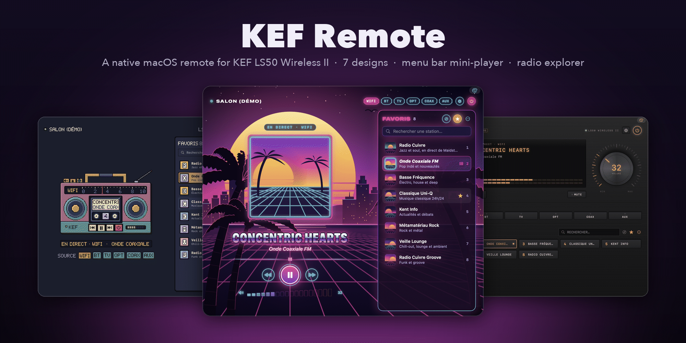
</p>

<h1 align="center">KEF Remote</h1>

<p align="center">
  <strong>A beautiful, native macOS remote for your KEF wireless speakers.</strong><br>
  Seven hand-drawn designs, a menu bar mini-player, a worldwide radio explorer and your favourite stations one click away.
</p>

<p align="center">
  
  
  
  
  
  <a href="LICENSE"></a>
</p>

<p align="center">
  Made for the <strong>KEF LS50 Wireless II</strong> &middot; designed to work with LSX II, LSX II LT and LS60
</p>

---

KEF Remote talks directly to your speakers over your home network. No account, no cloud, no
tracking. It comes in two flavours:

- **KEF Remote for macOS** (`mac/`): a native SwiftUI app, no dependencies. This is the star of the show.
- **Web client** (`app/`): a small FastAPI server plus a PWA you can open on any phone, tablet or browser on your network.

> [!NOTE]
> The app interface is currently in **French**. The screenshots below were taken in the built-in demo mode
> (fictional stations and tracks), so you can try everything without speakers.

## Features

- **7 designs**, switchable instantly from the palette button in the title bar, the menu bar mini-player,
  Settings or <kbd>⌃⌘1</kbd>…<kbd>⌃⌘7</kbd>. Every design keeps every feature.
- **Menu bar mini-player**: close the window and keep control from the menu bar, in the same design as the main window.
- **Radio explorer**: browse the speaker's airable radio catalogue by **country**, **genre** or **language**,
  play a station with one click and star it to add it to your favourites (<kbd>⌘E</kbd>).
- **Favourite radios**: logo grid, one-click playback, drag-and-drop reordering, search with suggestions from
  the speaker's listening history, <kbd>⌘1</kbd>…<kbd>⌘9</kbd> to jump to a station, <kbd>⌘D</kbd> to star the current one.
- **Now Playing and media keys**: track info shows up in Control Center's Now Playing, and your keyboard's
  play/pause/next/previous keys drive the speakers.
- **Full control**: play/pause, previous/next (zaps through your favourite stations when a radio is playing),
  volume and mute, sources (Wi-Fi, Bluetooth, TV, optical, coaxial, analog, depending on the model), power and standby.
- **Standby mode** in every design, with a big power button to wake the speakers.
- **Light and dark mode** follow macOS (some designs, like Analog Hi-Fi and Immersive Artwork, are always dark).
- **Automatic discovery** of KEF speakers on your network (Bonjour), or type the IP address yourself.
- **Demo mode** to try the whole app without speakers.

## Gallery

<p align="center">
  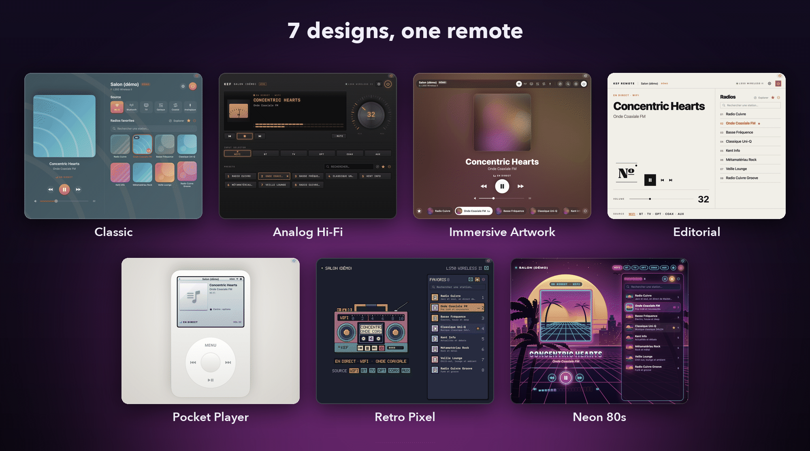
</p>

| | Design | What it looks like |
|---|---|---|
| 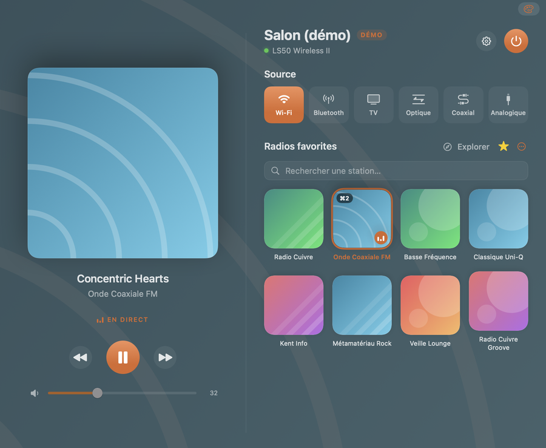 | **Classic**<br>*(Classique)* | The original look: translucent window, large artwork and a grid of station logos. |
| 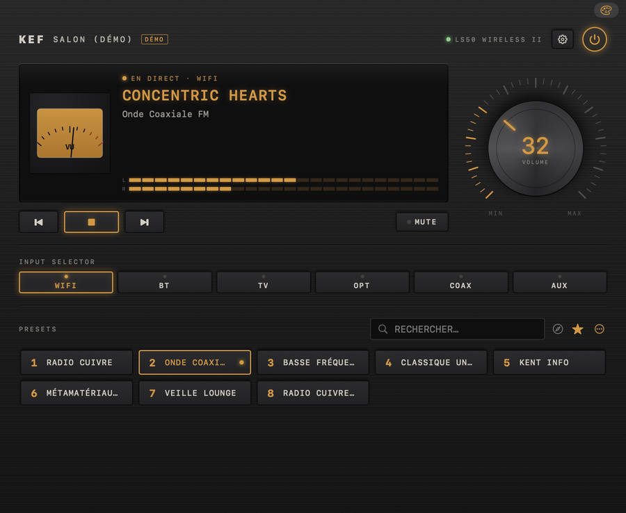 | **Analog Hi-Fi**<br>*(Hi-Fi analogique)* | An amplifier faceplate in brushed aluminium with amber accents, a big volume knob you can turn with the mouse, trackpad or arrow keys, source buttons, numbered presets and a decorative VU meter. |
| 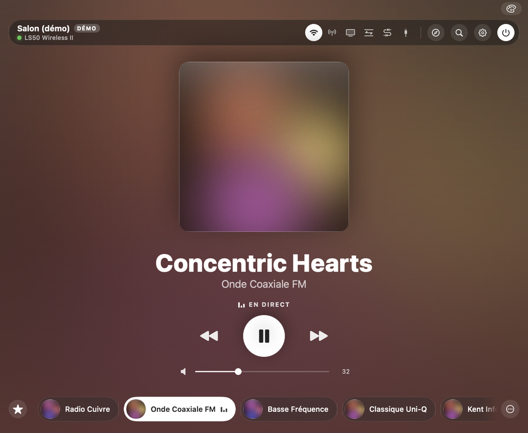 | **Immersive Artwork**<br>*(Pochette immersive)* | The cover art, heavily blurred, fills the whole window and tints it with its dominant colour. Huge title, big play button, favourites as pills along the bottom. |
| 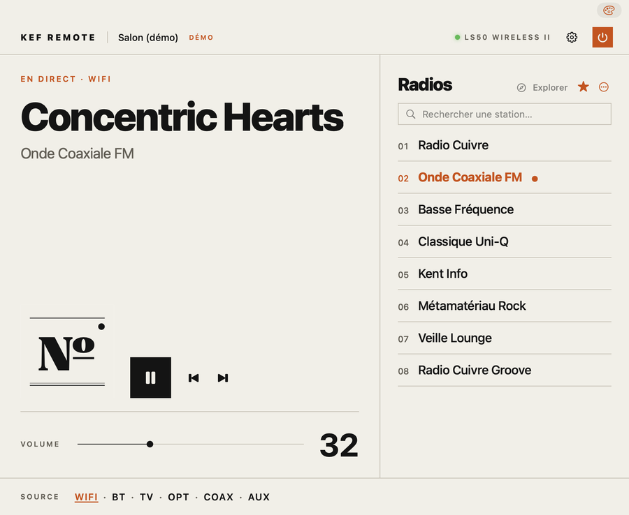 | **Editorial**<br>*(Éditorial)* | Warm paper background, oversized title, one-pixel rules and a single KEF orange accent. Favourites as a numbered list. |
| 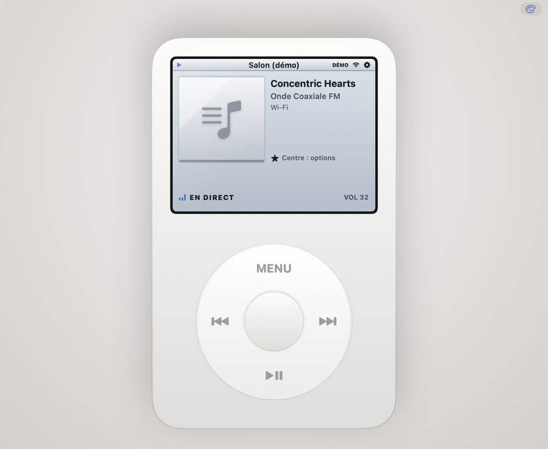 | **Pocket Player**<br>*(Baladeur)* | A 2000s-style pocket MP3 player with an LCD screen and a clickable scroll wheel: spin it to change the volume or scroll through menus, with haptic clicks on Force Touch trackpads. |
| 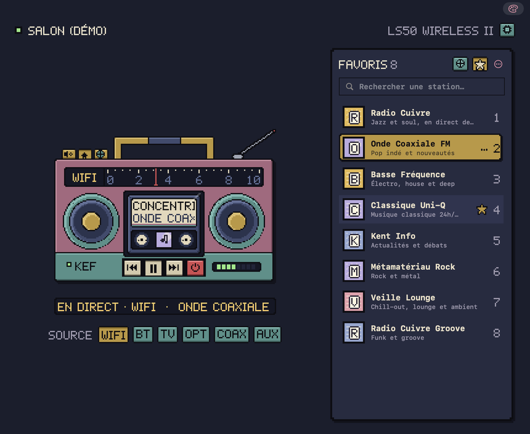 | **Retro Pixel**<br>*(Rétro pixel)* | A pixel-art boombox drawn in code. The dial needle is the volume, the cassette shows the title in a 5×7 bitmap font, the reels spin and the speakers pulse while music plays. |
| 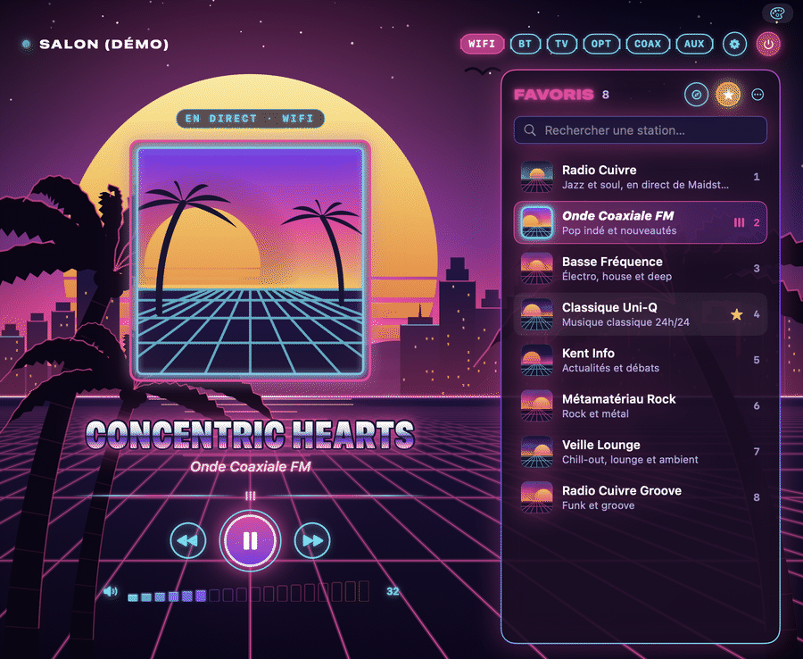 | **Neon 80s**<br>*(Néon 80)* | A synthwave poster drawn in code: striped sunset, palm trees, skyline and a neon grid that scrolls while music plays. Chrome lettering, glowing buttons and a bar-graph volume meter. |

Each design adapts to light and dark mode where it makes sense. Neon 80s, for instance, switches from an indigo night to a pastel golden hour:

<p align="center">
  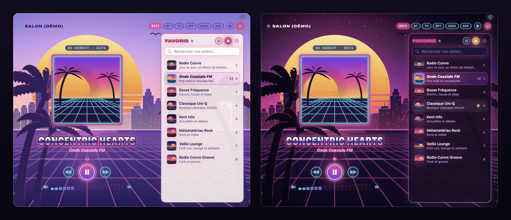
</p>

## Menu bar mini-player

Closing the window does not quit the app: KEF Remote stays in the menu bar with a compact player
(artwork, transport, volume, sources and favourite stations) and a row of thumbnails to switch design.

<p align="center">
  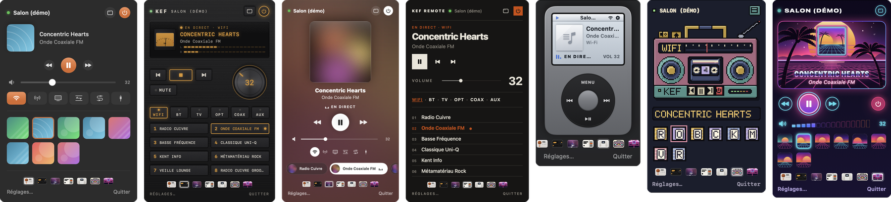
</p>

## Radio explorer

Open the explorer from the compass button next to your favourites, or press <kbd>⌘E</kbd>. Browse the
speaker's radio catalogue by country, genre or language, see popular and trending stations, click to play
and star a station to add it to your favourites.

<p align="center">
  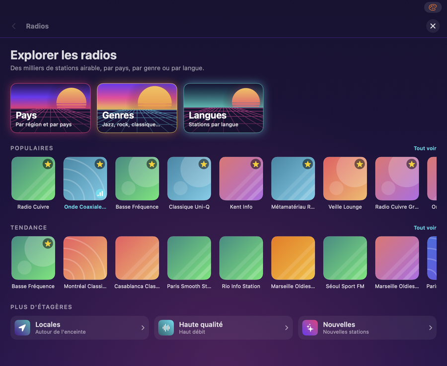
  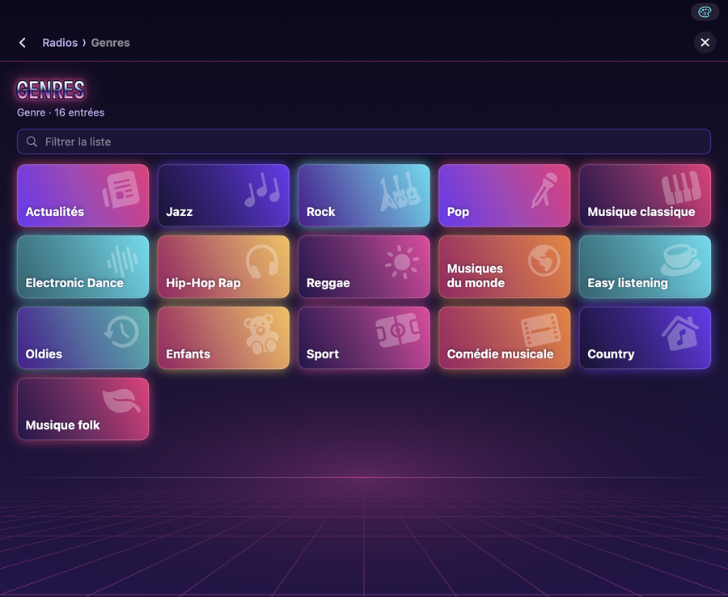
</p>

## Install (macOS app)

**Requirements:** macOS 14 Sonoma or later, Xcode or the Command Line Tools with Swift 6. No third-party dependencies.

KEF Remote is distributed as source code: build it on your Mac in about a minute.

```sh
git clone https://github.com/WedooitScom/kef-remote.git
cd kef-remote/mac
./build-app.sh                 # release build -> build/KEF Remote.app (ad hoc signed)
open "build/KEF Remote.app"
```

Then drag `build/KEF Remote.app` into your **Applications** folder (the script does not do it).

- `UNIVERSAL=1 ./build-app.sh` builds a universal binary (Apple silicon + Intel).
- `make demo` builds and launches the app in demo mode, or run `open -n "build/KEF Remote.app" --args --demo`.

> [!IMPORTANT]
> The app is **ad hoc signed and not notarized** by Apple. If you copy it to another Mac, the first time
> right-click the app and choose **Open** (or allow it in System Settings › Privacy & Security).
> Each rebuild changes the binary signature, so macOS may ask again for local network access.

**First launch**

1. macOS asks for permission to access the **local network**: allow it, otherwise the app cannot reach your
   speakers. If you declined, re-enable it in System Settings › Privacy & Security › Local Network.
2. Pick your speaker in the list of KEF speakers found on the network, or enter its IP address in Settings (<kbd>⌘,</kbd>).
3. Favourite radios are stored in `~/Library/Application Support/KEF Remote/favorites.json`
   (same format as the web client; use **Import…** to bring yours over).

<details>
<summary><strong>Keyboard shortcuts</strong></summary>

| Shortcut | Action |
|---|---|
| <kbd>Space</kbd> | Play / pause (except while typing) |
| <kbd>⌘↑</kbd> / <kbd>⌘↓</kbd> | Volume up / down |
| <kbd>⌥⌘↓</kbd> | Mute / unmute |
| <kbd>⌘←</kbd> / <kbd>⌘→</kbd> | Previous / next favourite station on a radio, otherwise previous / next track |
| <kbd>⌘1</kbd> … <kbd>⌘9</kbd> | Favourite stations 1 to 9 |
| <kbd>⌘D</kbd> | Add / remove the current station from favourites |
| <kbd>⌘E</kbd> | Radio explorer |
| <kbd>⇧⌘P</kbd> | Power on / standby |
| <kbd>⌃⌘1</kbd> … <kbd>⌃⌘7</kbd> | Classic / Analog Hi-Fi / Immersive / Editorial / Pocket Player / Retro Pixel / Neon 80s |
| <kbd>⌘,</kbd> | Settings (design, address, discovery, favourites) |

</details>

<details>
<summary><strong>Building and testing from the command line</strong></summary>

```sh
cd mac
swift build          # debug build
swift test           # unit tests (no network access)
./build-app.sh       # release .app bundle with icon and ad hoc signature
make demo            # build and launch in demo mode

# Launch options
open -n "build/KEF Remote.app" --args --demo                  # demo mode (or KEF_DEMO=1)
open -n "build/KEF Remote.app" --args --host 192.168.1.20     # force an address (not saved)
```

Read-only tests against a real speaker: `KEF_LIVE_HOST=192.168.1.20 swift test --filter LiveSpeakerTests`.

The screenshots in this README are generated by the app itself in demo mode:

```sh
"build/KEF Remote.app/Contents/MacOS/KEFRemote" --demo --design all --snapshot-extras \
  --appearance dark --snapshot /tmp/kef-shots --quit-after-snapshot
```

More details (design internals, minimum window sizes, API notes) in [mac/README.md](mac/README.md) (French).

</details>

## Web client

Prefer your phone? The web client is a small **FastAPI** server with a static, build-free PWA front end.
It updates in real time (Server-Sent Events fed by the speaker's long polling) and includes favourite radios
with search in the speaker's radio catalogue.

Requires [uv](https://docs.astral.sh/uv/) (Python 3.13 is pinned in `.python-version`; uv downloads it if needed).

```bash
uv sync
uv run kef                          # listens on 0.0.0.0:8000
KEF_HOST=192.168.1.42 uv run kef    # with your speaker's IP
KEF_DEMO=1 uv run kef               # demo mode, no speakers needed
uv run pytest                       # tests (demo mode)
```

Open <http://localhost:8000>. Without a configured address, the setup screen opens and searches the network.
On your phone, open `http://<your-computer-ip>:8000` (same Wi-Fi network) and add it to your home screen
(iOS: Share › Add to Home Screen; Android: ⋮ › Add to Home screen).

<details>
<summary><strong>Web client details: environment variables, shortcuts, API</strong></summary>

**Environment variables**

| Variable | Purpose | Default |
|---|---|---|
| `KEF_HOST` | IP or hostname of the primary speaker | none |
| `KEF_DEMO` | `1` to enable demo mode | off |
| `KEF_CONFIG` | Path to the config file | `config.json` |
| `KEF_FAVORITES` | Path to the favourite radios file | `favorites.json` next to the config |
| `KEF_BIND` | Listen address for `uv run kef` | `0.0.0.0` |
| `KEF_PORT` | Listen port for `uv run kef` | `8000` |

The address saved from the UI (`config.json`) takes precedence over `KEF_HOST`.

**Finding your speaker's IP**: use "search the network" in the UI (mDNS discovery of AirPlay / Chromecast /
Spotify Connect announcements, KEF devices highlighted), the KEF Connect app (speaker settings › network),
or your router's device list. Tip: reserve a static DHCP lease for the speaker. Only the primary speaker
(the one connected to the network) is needed.

**Keyboard shortcuts**: <kbd>Space</kbd> play/pause, <kbd>↑</kbd>/<kbd>↓</kbd> volume ±1 (±5 with Shift),
<kbd>←</kbd>/<kbd>→</kbd> previous/next track, <kbd>M</kbd> mute, <kbd>1</kbd>…<kbd>9</kbd> favourite station.

**Favourites** live in the client (`favorites.json`, ignored by git) and are synced live between open clients.
The app never writes to the speaker's presets or airable favourites; only `{id, title, path, icon, description}`
is stored and the stream is resolved again on each play.

**API** (interactive docs at <http://localhost:8000/api/docs>)

| Method | Route | Body / parameters |
|---|---|---|
| GET | `/api/state` | full state |
| GET | `/api/events` | SSE stream: `state`, then `patch`, and `favorites` |
| POST | `/api/power` | `{"on": true \| false \| null}` (null = toggle) |
| POST | `/api/source` | `{"source": "wifi"}` |
| POST | `/api/volume` | `{"volume": 30}` or `{"delta": -2}` |
| POST | `/api/mute` | `{"muted": true \| false \| null}` |
| POST | `/api/play-pause`, `/api/next`, `/api/previous` | none |
| GET | `/api/cover` | current artwork (proxy) |
| GET/POST | `/api/config` | `{"host": "192.168.1.42"}` |
| GET | `/api/discover` | speakers found via mDNS |
| GET | `/api/probe?host=` | test an IP |
| GET/POST | `/api/favorites` | list / add a station |
| DELETE | `/api/favorites/{id}` | remove a station |
| PUT | `/api/favorites/order` | `{"ids": [...]}` |
| POST | `/api/favorites/current` | add the station currently playing |
| POST | `/api/favorites/import` | import the speaker's radio history |
| POST | `/api/favorites/dismiss-suggestions` | hide suggestions |
| POST | `/api/radio/play` | `{"path": "airable:https://…"}` |
| GET | `/api/radio/search?q=` | stations (with `favorite`) |
| GET | `/api/radio/history` | recent stations |
| GET | `/api/radio/icon?u=` | logo proxy, restricted to `*.airable.io` |

```bash
curl -s localhost:8000/api/state | python -m json.tool
curl -s -X POST localhost:8000/api/volume -H 'content-type: application/json' -d '{"volume": 25}'
curl -N localhost:8000/api/events
```

**Architecture**

```
app/
  main.py        FastAPI: REST routes, SSE, artwork proxy, static files, `kef` entry point
  service.py     state, long-polling loop (backoff), SSE broadcast, commands
  connector.py   pykefcontrol connector (with fixes), models and sources
  radio.py       radios: favourites (favorites.json) and airable client (getRows / setData)
  demo.py        in-memory fake connector and radios (KEF_DEMO=1)
  discovery.py   best-effort mDNS discovery + IP probe
  config.py      KEF_HOST / config.json
  static/        index.html, styles.css, app.js, manifest, icons
```

A single background task polls the speaker and broadcasts changes; if the speaker stops answering, the UI
shows it offline and the service retries with exponential backoff (1 s to 30 s). Commands are applied
optimistically and confirmed by polling (rolled back on failure).

</details>

## Supported speakers

| Model | Status |
|---|---|
| KEF LS50 Wireless II | Developed and checked on this speaker (firmware V41192) |
| KEF LSX II, LSX II LT, LS60 | Should work (same local API); model and source lists are inferred and not yet verified on hardware |

Feedback from LSX II / LS60 owners is very welcome: please open an issue.

## How it works

Recent KEF wireless speakers expose a local HTTP API on your network (often called the NSDK / StreamUnlimited API).
KEF Remote uses it directly:

- **State and commands** via `getData` / `setData` (source, power, volume, transport).
- **Live updates** via the speaker's event queue (`modifyQueue` + long polling `pollQueue`), with automatic
  reconnection and exponential backoff.
- **Radios** via the speaker's built-in airable radio catalogue (`getRows`).

The web client relies on [pykefcontrol](https://github.com/N0ciple/pykefcontrol) (with a couple of fixes
for 0.9.3), while the macOS app reimplements the protocol natively in Swift (`mac/Sources/KEFKit`).

<details>
<summary><strong>Known limitations</strong></summary>

- **Pause on a live radio**: the speaker ignores `pause` for live airable streams, so the app sends `stop`
  and resuming replays the station.
- **Mute** is volume 0 with the previous volume remembered (like pykefcontrol).
- **Media keys**: macOS sends them to the most recent "Now Playing" app. If Music, Spotify or a browser
  plays audio afterwards, they receive the keys until KEF Remote's state changes again.
- No seeking within a track and no play queue.
- The Analog Hi-Fi VU meter is decorative (the speaker does not report audio levels).
- Models other than the LS50 Wireless II: sources are inferred from the firmware release text and not verified.
- No authentication on the web client: only run it on a trusted local network.

</details>

## Privacy

Everything stays on your local network. KEF Remote talks only to your speakers (and, for station logos and
radio streams, to the services your speaker already uses). No account, no analytics, no telemetry.
Your speaker address and favourite stations are stored locally on your Mac (or next to the web server).

## Disclaimer

KEF Remote is an independent, unofficial project. It is **not affiliated with, endorsed by or supported by
KEF** or GP Acoustics. "KEF", "LS50", "LSX" and "LS60" are trademarks of their respective owners and are
used here only to describe compatibility. Use at your own risk.

## Credits

- [pykefcontrol](https://github.com/N0ciple/pykefcontrol) by N0ciple (MIT), which documented the KEF local API
  and powers the web client.
- Radio catalogue provided by your speaker through airable.

## License

[MIT](LICENSE)
